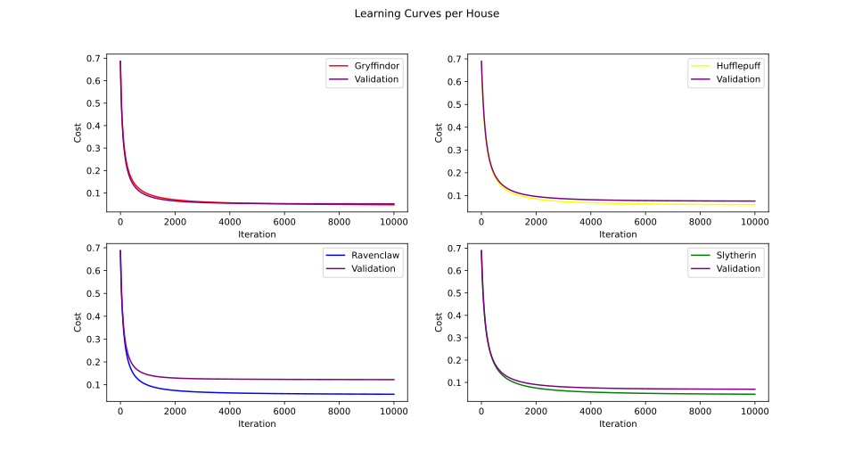
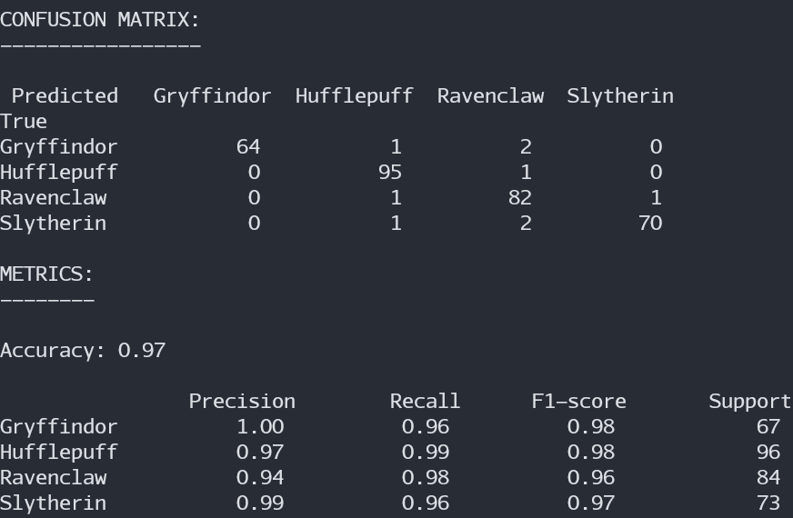

# dslr




Predicts a student's Hogwarts house from their grades, using a hand-written one-vs-all logistic regression (sigmoid, log-loss, gradient descent). pandas, numpy and matplotlib are used for loading the CSV files, for the computations and for the plots. The statistics and the metrics do not rely on scikit-learn.

## Installation

Python 3.10 or later.

```bash
python3 -m venv venv
source venv/bin/activate
pip install -r requirements.txt
```

## Usage

```bash
python describe.py datasets/dataset_train.csv
python histogram.py datasets/dataset_train.csv
python scatter_plot.py datasets/dataset_train.csv
python pair_plot.py datasets/dataset_train.csv

python logreg_train.py datasets/dataset_train.csv
python logreg_predict.py datasets/dataset_test.csv model.json
```

`histogram.py` and `scatter_plot.py` open a window. `pair_plot.py` writes `pair_plots.pdf`. Training overwrites `model.json`. Prediction writes `houses.csv`.

To evaluate the model on data it has not seen:

```bash
python logreg_train.py datasets/dataset_train.csv \
    --validation-ratio 0.2 --metrics --confusion-matrix
```

`--validation-ratio` must be in `[0, 1)`. `--learning-curve` plots the loss. On an 80/20 split, the accuracy is about 0.97.

## Model

Missing values are replaced with the training set median, then the grades are standardized. Arithmancy, Care of Magical Creatures and Defense Against the Dark Arts are dropped: they do not help separate the houses. One classifier is trained per house. `model.json` stores the means, standard deviations, medians and weights, so that prediction applies the same preprocessing.
